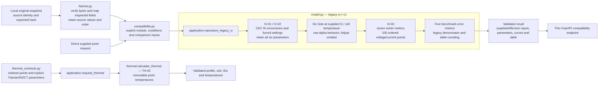
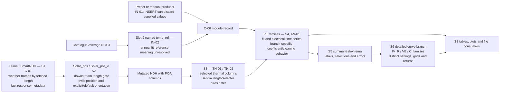
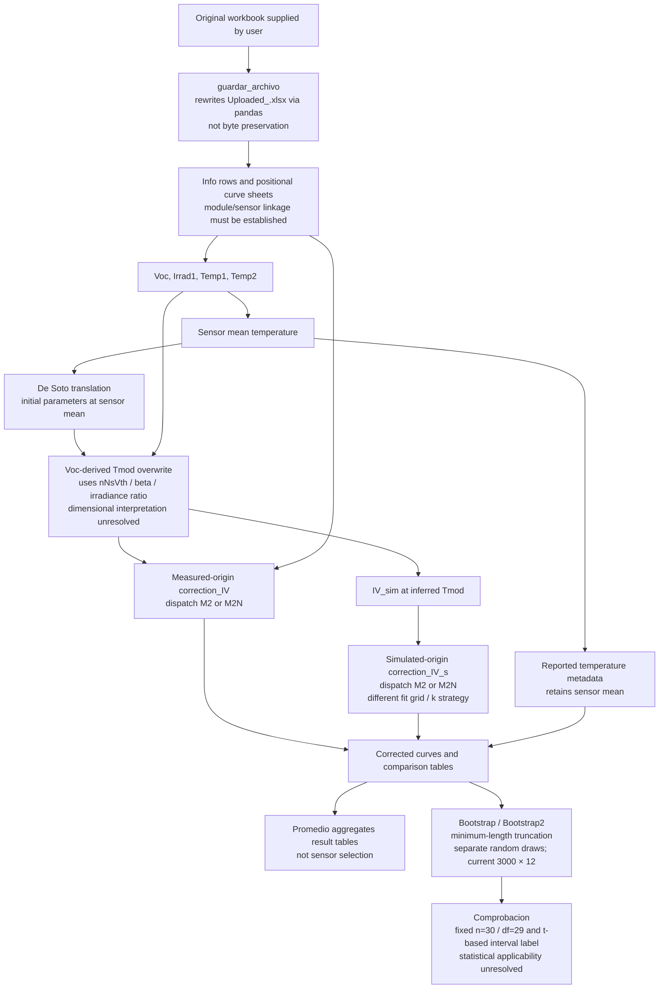

# Backend transformation lineage

Each diagram states whether it describes modern implementation or frozen legacy
source. A solid arrow records a transformation in that boundary, not proof that
every input/branch has executed. Modern coverage is owned by the [coverage map](legacy_backend_coverage.md);
meanings and equations are owned by [assumptions](assumptions.md).

## Implemented modern point calculations

Source mapping ends before coefficient interpretation. The model owns
fit conversions, overrides, solver/grid and error meaning. Thermal is a direct
Python point use case; this diagram does not implement weather acquisition or an
annual workflow. The reserved general simulator remains unavailable.

## Observed legacy weather-to-electrical chain

This is source lineage, not modern annual reproduction. Acquisition
can retain lengths that downstream consumers ignore. Unused manual seasonal
calculations can still require fields/fail, but the returned POA chain consumes
pvlib position. The catalogue temperature mapping and upstream preset/manual
behavior must remain visible before sharing a numerical kernel.

## Observed measurement, correction and statistical chain

This representative source chain preserves three different temperature
roles and separates correction method from curve origin/fit strategy. It does not
replace the branch-specific code or prove statistical validity. The supplied
summary's reported bootstrap method differs from current source. Original
measurements, historical algorithm identity, RNG state and calibration/evaluation
lineage are still needed; see EV-01 and the original chapters 03/08/10.

## Verification boundary

Independent original-source captures feed the compatibility comparisons described
in [reproduction](reproduction.md). Schema checks, numerical reproduction,
scientific formulation checks, observations and calibration have separate evidence
requirements. Neither these diagrams nor current tests approve a disputed modeling
choice or the full backend.
