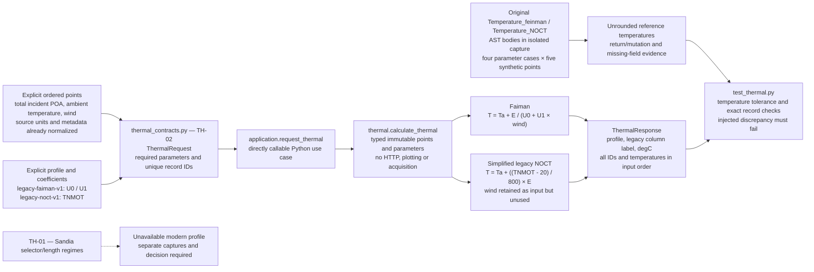
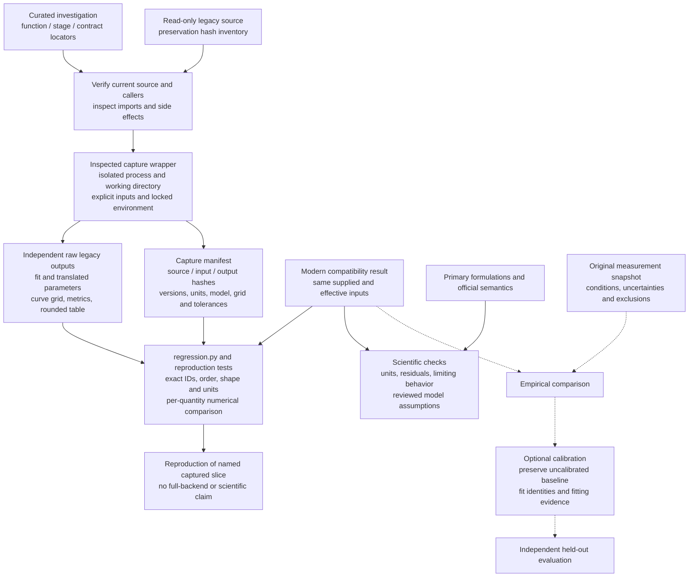

# Backend transformations and evidence flow

These diagrams extend the curated [S0–S8 data history](legacy-refactorizacion/02-historia-del-dato.md)
without adopting its proposed Dash architecture. Solid arrows describe the
selected executable compatibility pathway or evidence-checking flow; dashed
arrows describe deferred or conditional work. See the [coverage map](legacy_backend_coverage.md)
for actual reproduction status and [assumptions](assumptions.md) for stable
operation IDs, equations, sources and open scientific questions.

## Explicit local input through compatibility output

```mermaid
flowchart LR
    subgraph acquisition["fetcher.py — source acquisition and normalization"]
        raw["Local original JSON snapshot<br/>source and record identity"] --> hash["Verify expected SHA-256<br/>preserve original bytes"]
        hash --> map["Explicit field-name mapping<br/>retain percent coefficients and case order"]
    end
    map --> input["compatibility.py<br/>LegacyIVModule / LegacyIVRequest<br/>units, domains and required benchmark fields"]
    direct["Explicit compatibility request"] --> input
    input --> usecase["application.reproduce_legacy_iv<br/>model_id: legacy-iv-r-v1"]
    subgraph numerical["model.py — parameterization and calculation"]
        usecase --> fit["fit_legacy_iv — IV-01 / IV-02<br/>CEC alpha/beta conversions<br/>effective monoSi and 25°C"]
        fit --> params["Six CEC parameters<br/>retain Adjust as evidence"]
        params --> translate["solve_legacy_iv — IV-02<br/>De Soto translation<br/>raw source alpha; Adjust omitted"]
        translate --> solver["IV-03 — Lambert W<br/>five electrical metrics<br/>100 ordered voltage/current points"]
        solver --> table["IV-03 — benchmark errors<br/>simulated-value denominator<br/>legacy table rounding only"]
    end
    table --> output["Validated compatibility result<br/>supplied cases and exact fit/De Soto inputs<br/>effective choices, parameters, curves and table"]
    output --> api["api.py — thin transport<br/>POST /api/v1/compatibility/iv-r"]
    general["General module-IV request"] --> unavailable["Explicit 501 unavailable<br/>no scientifically accepted default"]
```

Field mapping is normalization. Percent conversion, reference-condition overrides,
fitting, translation, solver/grid selection and error denominators are modeling
interpretations owned by `model.py`. Snapshot loading never computes these values.
No interpolation, imputation, aggregation, measurement calibration or live network
acquisition occurs in this pathway. Supplied source values and effective settings
must remain distinguishable, including the source material versus forced monoSi.

## Captured thermal point kernels

The Pydantic/typed boundaries enforce finite inputs, nonnegative irradiance/wind,
ambient temperature above absolute zero, explicit positive U0/U1 and a finite
positive Faiman loss factor, or explicit TNMOT >20°C. These are supported-domain
restrictions. Coefficients have no implicit default. The original NDH functions
mutate frames and return `None`; modern kernels return immutable ordered values.
The [thermal capture record](../tests/fixtures/legacy/thermal/README.md) preserves
that difference. Point-kernel reproduction and equation/reference checks do not
establish calibrated coefficients, measured cell temperatures or annual-chain
reproduction. No weather acquisition is implemented by this diagram.

## Independent capture and distinct acceptance gates

Expected numerical results originate in executed legacy code; the modern
implementation never generates its own oracle. Independent residual arithmetic
checks solver consistency with the stated equation. Calling pvlib twice can
establish neither independent scientific validation nor measurement agreement.
The five gates in [reproduction](reproduction.md) remain separately assessable.

## Deferred annual and empirical pathways

```mermaid
flowchart LR
    weather["S1 — raw weather snapshot<br/>request metadata, timestamps and hash"] -.-> time["WX-01 — explicit time interpretation<br/>interval, DST, leap-day and missing records"]
    time -.-> poa["S2 — solar geometry and POA<br/>orientation, transposition and losses"]
    poa -.-> thermal["S3 — thermal parameterization<br/>TH-01 / TH-02<br/>mounting and wind-height assumptions"]
    thermal -.-> annual["S4 — annual electrical branches<br/>AN-01; separate PE / PE_NOCT / PE_t paths"]
    annual -.-> extremes["S5 — extrema and summaries<br/>exact labels and record selection"]
    extremes -.-> iv["S6 — branch-specific I–V<br/>IV_R / IV_R_VE / IV_CI families<br/>distinct grids and output contracts"]
    workbook["Original measurement workbook<br/>raw bytes, sheet identities and Info records"] -.-> measurement["EV-01 — measurement normalization<br/>units and sensor metadata<br/>preserve all records and exclusions"]
    measurement -.-> correction["S7 — versioned correction variants<br/>unfitted baseline and fit provenance"]
    iv -.-> correction
    correction -.-> statistics["Representative curve and intervals<br/>RNG state, alignment and sample rules"]
    annual -.-> presentation["S8 — output contracts and presentation"]
    statistics -.-> presentation
    iv -.-> presentation
```

All arrows in this final diagram are deferred modern integrations. The separately
implemented IV_R and Faiman/NOCT point kernels do not reproduce the upstream
weather/thermal/annual orchestration, dashboard selector combinations, other
I–V methods or correction/statistics.
The curated material already identifies these paths; new investigation should
target the next unresolved owner or evidence gap in the coverage map. New Node.js
frontend capabilities wait for the explicit full-backend reproduction gate.
