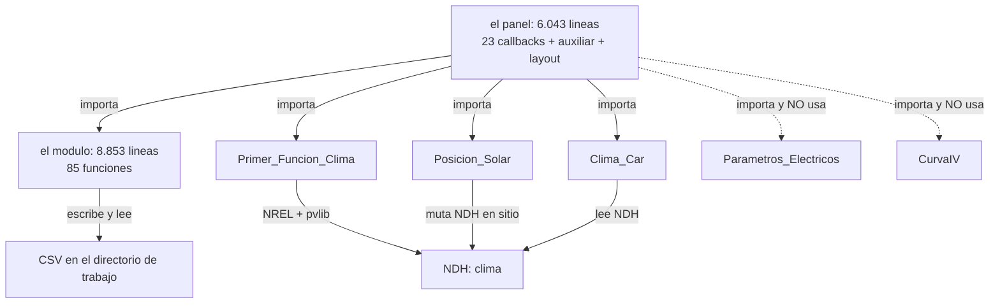

# 01 — El sistema en una página

> Resumen de la investigación del autor sobre `legacy/`. Las cifras y sus límites están en el
> [README](README.md) §1; el backend actual se consulta en [cobertura](../legacy_backend_coverage.md).

---

## Qué es

Una aplicación de escritorio-monolito en **Python + Plotly Dash** para analizar módulos
fotovoltaicos: descarga el clima de un sitio (NREL NSRDB), calcula irradiancia en el plano,
estima temperatura con tres modelos y produce series eléctricas e I-V. El panel también conecta
corrección y comparación de mediciones. Este alcance describe rutas implementadas; sus defectos
y la cobertura de ejecución se evalúan por separado.

El autor lo vincula con su informe de licenciatura (UNAM, 2025) sobre simulación, corrección y
validación de curvas I-V. Su conocimiento del sistema orienta la investigación; los juicios
sobre comportamiento y ciencia se contrastan con código, capturas y fuentes.

---

## Las tres entradas

| Entrada | Qué aporta el usuario | Qué dispara |
|---|---|---|
| **Sitio y clima** | latitud, longitud, año típico (TMY) o año concreto (1998–2020), inclinación y azimut | descarga NREL y toda la cadena hasta las series anuales |
| **Módulo** | 11 parámetros de ficha técnica, o un módulo del catálogo CEC (`Libro1.xlsx`), o un módulo de prueba fijo | los diccionarios de placa y el cálculo eléctrico |
| **Mediciones** | un `.xlsx` con una hoja por curva I-V medida y una hoja `Info` al final | el tramo de corrección y comparación |

## Las tres salidas

1. **Series anuales** de `Isc`, `Voc`, `Imax`, `Vmax`, `Pmax` por modelo térmico activo, con
   gráficas de dispersión e histogramas.
2. **Curvas I-V** en condiciones representativas, o en las condiciones que fije el usuario, o
   frente a una curva medida.
3. **Tablas comparativas** y, cuando hay corrección, una curva representativa con intervalo
   nominal al 95 % sobre las mediciones; el rótulo no acredita cobertura empírica. Véase EV-01
   en [suposiciones](../assumptions.md). #to-review

---

## Dentro: dos ficheros y cinco módulos

Tres cosas que hay que saber de esta estructura:

1. **El módulo no importa al panel**, pero sí depende de Dash y Plotly: contiene factorías de
   pantalla y motores que devuelven figuras. No hay una separación completa entre cálculo y UI.
   El backend moderno separa esas responsabilidades según [arquitectura](../architecture.md). #to-review
2. **Dos funciones tienen el mismo nombre y ambas están vivas**: `electric_parameters`
   (`1148` y `4182`) y `Voltaje_Corriente_Selector` (`1723` y `1742`). El decorador de Dash registra
   la primera referencia antes de que la segunda reasigne el símbolo, así que hablan dos funciones
   distintas con el mismo nombre. Estos dos nombres requieren distinguir también su línea.
3. **Las series se comunican mediante ficheros en el directorio de trabajo**, y los stores
   transportan sus rutas. Los stores de corrección también llevan tablas y curvas reales (C-04).
   Los nombres compartidos y el borrado previo permiten interferencias entre sesiones. #to-review

---

## Qué hace falta para que arranque

| Requisito | Estado |
|---|---|
| `dash`, `dash-bootstrap-components`, `dash-leaflet`, `plotly`, `cufflinks` | instalables |
| `pvlib` | **0.11.0** reportado en la máquina original de análisis; `Clima` elige PSM4/PSM3 mediante `hasattr`, por lo que la ruta efectiva depende del entorno de captura. #to-review |
| `openpyxl`, `pandas`, `numpy`, `scipy`, `timezonefinder`, `pytz` | instalables |
| Credenciales NREL | necesarias para ejecutar S1; `Clima` admite argumentos explícitos o variables de entorno. No prueban un requisito universal de arranque de Dash. |
| `Libro1.xlsx` (catálogo CEC) | **no suministrado**: solo afecta al modo `CEC` |

El bloque principal del panel llama a `app.run(debug=True)` (`6041-6042`). No hay un ejecutor
unificado de escenarios, pero los helpers sí son invocables: `Clima(lat, lon, A, ...)` admite
años y credenciales explícitos y devuelve `SmartNDH`, incluso desempaquetable en `(df, metadata)`.
La captura aislada debe revisar efectos laterales e importaciones de cada frontera. #to-review

---

## Veredicto en tres frases

1. **Las rutas nombran métodos reconocibles**: pvlib, De Soto, CEC/SAM y corrección M2/M2N.
   Su uso no acredita conformidad con IEC 60891 ni coherencia de unidades; esas cuestiones
   siguen en [evidencia](../evidence.md) y [suposiciones](../assumptions.md). #to-review
2. **La repetición concentra mantenimiento**: seis funciones suman 7.013 líneas, el 51,9 % de
   las líneas de funciones. El 91 % de duplicación es una métrica reportada sin script disponible;
   los 84 `if Metodo ==` sí se contrastaron en el callback de curvas.
3. **Falta el juez de todas las rutas**: ya existen capturas parciales, sin reproducción completa
   del panel. [Cobertura](../legacy_backend_coverage.md) identifica las comparaciones y los
   bloqueos restantes; este resumen no sustituye ese registro.

---

## Lo que esta página no afirma

- No dice que la app funcione: **no se ha ejecutado** en este análisis.
- No acredita resultados numéricos: el autor reporta 30 curvas de un módulo; el libro no está
  disponible aquí y ese alcance tampoco validaría todas las rutas del sistema. #to-review
- No propone arquitectura: eso está en [09](09-refactor-propuesto.md) y en
  [10](10-decisiones-pendientes.md).
