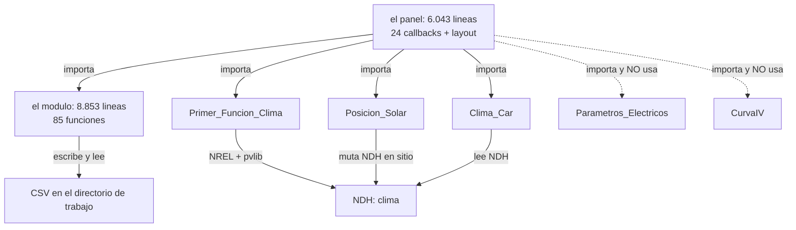

# 01 — El sistema en una página

> Si solo vas a leer una página, que sea esta. **Verificado** contra `legacy/`; las cifras exactas
> están en el [README](README.md) §1.

---

## Qué es

Una aplicación de escritorio-monolito en **Python + Plotly Dash** para analizar módulos
fotovoltaicos: descarga el clima de un sitio (NREL NSRDB), calcula la irradiancia en el plano del
módulo, estima la temperatura de célula con tres modelos térmicos, traduce esos datos a parámetros
eléctricos horarios durante un año, resuelve la curva I-V con el modelo de un diodo y, si hay
mediciones de un trazador de curvas, las corrige a condiciones estándar y las compara con la
simulación.

Nació como el software de un informe de licenciatura (UNAM, 2025) sobre simulación, corrección y
validación de curvas I-V. **El sistema entero es de una sola persona, sin formación de
programación**, y eso explica su forma mejor que cualquier crítica de estilo.

---

## Las tres entradas

| Entrada | Qué aporta el usuario | Qué dispara |
|---|---|---|
| **Sitio y clima** | latitud, longitud, año típico (TMY) o año concreto (1998–2020), inclinación y azimut | descarga NREL y toda la cadena hasta las series anuales |
| **Módulo** | 11 parámetros de ficha técnica, o un módulo del catálogo CEC (`Libro1.xlsx`), o un módulo de prueba fijo | los diccionarios de placa y el cálculo eléctrico |
| **Mediciones** | un `.xlsx` con una hoja por curva I-V medida y una hoja `Info` al final | el tramo de corrección y comparación |

## Las tres salidas

1. **Series anuales** de `Isc`, `Voc`, `Imax`, `Vmax`, `Pmax` por modelo térmico activo, con
   gráficas de dispersión e histogramas.
2. **Curvas I-V** en condiciones representativas, o en las condiciones que fije el usuario, o
   frente a una curva medida.
3. **Tablas comparativas** y, cuando hay corrección, la **curva representativa** con intervalo de
   confianza al 95 % sobre el conjunto de mediciones.

---

## Dentro: dos ficheros y cinco módulos

Tres cosas que hay que saber de esta estructura:

1. **La dependencia va en una sola dirección**: el panel lo llama todo; el módulo no sabe que
   existe una pantalla. Eso es sano y hay que conservarlo.
2. **Dos funciones tienen el mismo nombre y ambas están vivas**: `electric_parameters`
   (`1148` y `4182`) y `Voltaje_Corriente_Selector` (`1723` y `1742`). El decorador de Dash registra
   la primera referencia antes de que la segunda reasigne el símbolo, así que hablan dos funciones
   distintas con el mismo nombre. Buscar por nombre en este código **siempre** devuelve dos sitios.
3. **La comunicación interna es por ficheros en el directorio de trabajo.** Los callbacks no se
   pasan datos: se pasan listas de nombres de CSV a través de `dcc.Store` y releen del disco. Eso
   impide que dos sesiones convivan y hace que cada cambio de filtro vuelva a leer el archivo.

---

## Qué hace falta para que arranque

| Requisito | Estado |
|---|---|
| `dash`, `dash-bootstrap-components`, `dash-leaflet`, `plotly`, `cufflinks` | instalables |
| `pvlib` | **0.11.0** en la máquina de análisis; la rama PSM4 del código no existe en esa versión |
| `openpyxl`, `pandas`, `numpy`, `scipy`, `timezonefinder`, `pytz` | instalables |
| `NREL_API_KEY` y `NREL_API_EMAIL` en `.env` | **no suministradas**: sin ellas S1 no corre |
| `Libro1.xlsx` (catálogo CEC) | **no suministrado**: solo afecta al modo `CEC` |

Y el detalle que rompe la reproducibilidad: **`python3 GIU_Final_Presetacion.py` sin argumentos
lanza la app en `:8050`**, pero no existe ningún punto de entrada programático. Toda la lógica se
invoca desde callbacks de Dash, así que «ejecutar un caso» hoy significa abrir la interfaz y
teclear. Es el obstáculo principal para congelar salidas.

---

## Veredicto en tres frases

1. **La física está bien planteada y hay que conservarla**: pvlib para clima y posición solar, De
   Soto y CEC/SAM para la curva, corrección M2/M2N conforme a IEC 60891. Lo que falta no es ciencia,
   es estructura.
2. **El problema es la copia**: 52 % del código en 6 funciones, 91 % de una de ellas duplicado
   exacto, 84 bloques de cálculo escritos a mano para 5 dimensiones que deberían ser configuración.
3. **Lo que no existe es el juez**: no hay captura independiente de las salidas del sistema actual,
   así que no hay forma de demostrar que un refactor conserva el comportamiento. Sin eso, cualquier
   reescritura es una apuesta.

---

## Lo que esta página no afirma

- No dice que la app funcione: **no se ha ejecutado** en este análisis.
- No dice que los resultados numéricos sean correctos: la validación del informe de licenciatura se
  hizo contra 30 curvas de un módulo, no contra el sistema completo.
- No propone arquitectura: eso está en [09](09-refactor-propuesto.md) y en
  [10](10-decisiones-pendientes.md).
