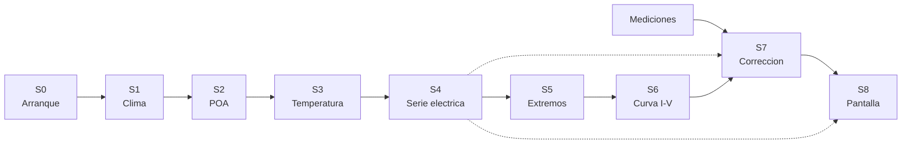

# 02 — La historia del dato: de la coordenada a la curva

> El espinazo de la investigación: nueve estados, S0–S8, descritos por entradas, salidas,
> funciones, llamadores y condiciones de fallo. No acredita una ejecución completa. #to-review

**Convención de este documento:** todo lo que dice «línea» está en `legacy/`, y `el panel` es
`GIU_Final_Presetacion.py` (6.043 líneas) mientras `el módulo` es `Input_File_DIV_Mac_Informe.py`
(8.853). Las etiquetas de confianza son las del [README](README.md) §5.

---

## S0 — Arranque y superficie de entrada

**Qué entra.** Nada: el proceso arranca con valores por defecto.

**Qué sale.** El árbol de pantalla (`layout`) con todos los controles, y una aplicación Dash
escuchando en `:8050`.

| Función | Líneas | Qué hace |
|---|---|---|
| (cuerpo de `layout`) | panel `107-654` | construye la pantalla llamando a 22 factorías del módulo |
| `toggle_inputs` | panel `675-689` | decide qué inputs se muestran según el modo de placa |
| `filter_data`, `shower_list`, `data_handler` | panel `698-805` | filtran el catálogo CEC desde `Libro1.xlsx` |
| `update_map_center`, `angles_show`, `update_year_dropdown_visibility` | panel `816-1096` | mapa, ángulos y visibilidad de años |
| factorías de control | módulo `41-661` | `table_module`, `Dropdown_1..4`, `lat`, `lon`, `tilt`, `Azimuth`, `time_range`, `Data_filter`, `creador_de_filtros` |

**Quién manda a hablar.** Nadie. Es el punto de entrada: `app.run(debug=True)` en el panel
`6041-6042`, guardado por `if __name__ == '__main__'`. No hay un ejecutor unificado de escenarios;
sí existen helpers programáticos, incluido `Clima` con año y credenciales explícitos. La captura
necesita aislar sus dependencias y efectos laterales (ver [reproducción](../reproduction.md)). #to-review

**Qué se rompe.** La salida de seguridad de `toggle_inputs` devuelve un dict para 13 salidas
(panel `689`), alcanzable con selección vacía/no reconocida. El control arranca con `SELEC`
(`143`): no se ha demostrado fallo al inicio normal. El error concreto depende de Dash. Los
nombres de `678` sí son globales del panel (`92-102`). #to-review

**Contrato que produce.** Ninguno de datos; produce **configuración**: once valores por defecto del
módulo de prueba (`Pot=250`, `Vm=30.12`, `Voc=37.85`, …) y seis casos de irradiancia/temperatura.

---

## S1 — Clima: de una coordenada a un diccionario de series

**Qué entra.** Latitud, longitud, `SY` con años concretos, un año directo o `TMY`; intervalos y
credenciales explícitos o del entorno. TMY fija `time_step=60` e ignora el intervalo solicitado
(`Primer_Funcion_Clima.py:64-173`). #to-review

**Qué sale.** `SmartNDH`, subclase de dict con claves `float` de longitud y listas de DataFrames.
Inicializa cuatro claves conocidas y agrega otras longitudes si las recibe. `.items()` mantiene
la ruta del panel; la iteración devuelve `(df, metadata)` de la **última respuesta**, no un archivo
de metadatos por año (`Primer_Funcion_Clima.py:43-56, 118-121, 173-183`). Las columnas consumidas
incluyen `temp_air`, `wind_speed`, `ghi`, `dni`, `dhi`, `albedo` y componentes de fecha. #to-review

| Función | Líneas | Qué hace |
|---|---|---|
| `clima` (callback) | panel `853-936` | orquesta la descarga y devuelve 7 salidas |
| `Clima` | `Primer_Funcion_Clima.py:64-183` | descarga NREL (PSM4 si existe, si no PSM3) |
| `obtener_utc_de_coordenadas` | `Primer_Funcion_Clima.py:24-40` | desfase horario **de hoy**, no del año analizado |
| `table_e`, `TMY` | módulo `167-276` | convierten `NDH` en tabla visible |
| `creador_csv_clima` | módulo `828-855` | escribe `g_{año}_{n}.csv` y devuelve la lista de rutas |

**Quién manda a hablar.** El callback `clima`, disparado por latitud, longitud, año y métodos
térmicos seleccionados. Dentro, el panel llama a `pf.Clima` y después a `cl.clc` y `ps.Solar_pos`
(S2).

**Qué garantiza.** Agrupa cada respuesta descargada bajo su longitud; no garantiza datos en cada
resolución. El escritor posterior nombra los CSV aceptados `g_{año}_{n}.csv`. #to-review

**Qué no garantiza.** No valida integridad temporal ni columnas. `Clima` conserva longitudes
no estándar; consumidores como `Solar_pos`, `Temperature_sandia` y `creador_csv_clima` solo procesan
las cuatro reconocidas. El nombre del índice se hereda del proveedor (ver `00` §3). #to-review

**Qué se rompe.** Si faltan credenciales tanto en argumentos como en el entorno, `Clima` lanza
`ValueError` antes de descargar (`70-78`). El autor reporta pvlib 0.11.0/PSM3 en su entorno; el
código selecciona PSM4/PSM3 por disponibilidad y cada captura debe registrar la rama efectiva. #to-review

---

## S2 — Irradiancia en el plano: el estado invisible

**Qué entra.** El mismo objeto `NDH` de S1.

**Qué sale.** **Nada.** `Solar_pos` no devuelve valor: **modifica los DataFrames en sitio**, añadiendo
`Poa_global`, `Poa_direct`, `Poa_diffuse`, `Poa_sky_diffuse` y `Poa_ground_diffuse`.

| Función | Líneas | Qué hace |
|---|---|---|
| `Solar_pos` | `Posicion_Solar.py:36-112` | inclinación = latitud, azimut = 180 |
| `Solar_pos_e` | `Posicion_Solar.py:116-192` | inclinación y azimut explícitos |
| `clc` | `Clima_Car.py:3-40` | agrupa temperaturas mínimas/máximas por hora; **su resultado se descarta** |

**Quién manda a hablar.** `clima`, en el panel `904-912`, según `Posicion_Modulo` (`Pos_i` o `Pos_e`).

**Por qué este estado es el más peligroso de todos.** Tres motivos:

1. **La comunicación es por efecto secundario.** El panel escribe
   `Effective_irradiance = ps.Solar_pos(...)` y esa variable vale `None`: nunca se usa. Quien consume
   la irradiancia no recibe un valor, sino los DataFrames mutados.
2. **S2 debe preceder a S3**: `Solar_pos` añade `Poa_*`; S3 lee `lista.Poa_global`. Ejecutar S3
   antes de crear esa columna puede producir `AttributeError` inmediatamente. `clc` solo construye
   su propio resultado a partir de clima y no es un productor de POA. #to-review
3. **`clc` se ejecuta para nada**: su resultado se tira en las dos ramas (panel `906` y `910`),
   y es un recorrido completo de todas las series.

**Qué revisar.** `AMi = 1/cos(zenit)` no está acotado (`Posicion_Solar.py:84, 164`): su signo y
magnitud requieren control de dominio. La función pasa ese término a la transposición sin fijar
el modelo; su efecto efectivo depende de pvlib y no se ha medido aquí. La limpieza posterior de
`Voc`/`Vmax`/`Pmax` es desigual, pero no prueba por sí sola esa cadena causal. #to-review

---

## S3 — Temperatura de célula: tres modelos, un resultado

**Qué entra.** `NDH` ya con `Poa_global`.

**Qué sale.** Tres columnas nuevas, una por modelo activo: `TFeinman`, `Tsandia`, `NOCT`.

| Función | Líneas | Modelo |
|---|---|---|
| `Temperature_feinman` | módulo `805-814` | `pvlib.temperature.faiman` con `u0`, `u1` ajustables |
| `Temperature_sandia` | módulo `785-800` | exponencial SAPM + conversión módulo→célula |
| `Temperature_NOCT` | módulo `817-825` | `T_a + (T_NOCT − 20)/800 · G` |

**Quién manda a hablar.** `clima`, panel `914-923`, según qué números haya en `checklist-input`.

**Qué revisar.** Los tres helpers requieren `Poa_global`, `temp_air` y `wind_speed`, aun cuando
NOCT no usa el viento en su ecuación. Faiman y NOCT recalculan cuatro veces cada serie sin filtro
de longitud; Sandia sí filtra las cuatro longitudes. Sandia tiene seis pares `a/b`, pero solo
cuatro `deltaT`: la UI expone selectores 1–4 (`762-783`), mientras 5/6 fallarían al llamar al helper
directamente. La ausencia de una columna puede fallar en S3 o después; no hay validación formal
de estas fronteras. #to-review

---

## S4 — Serie eléctrica anual: el motor y su bus

**Qué entra.** `NDH` (por los CSV `g_*.csv`) y un diccionario de placa.

**Qué sale.** Un CSV por serie y por módulo (`PE_{año}_{n}.csv`, `PE2_{año}_{n}.csv`) con las
magnitudes horarias: `Isc0_*`, `Voc_*`, `Imax_*`, `Vmax_*`, `Pmax_*`, `Gamma_*` y la temperatura
usada, donde `*` es `F`, `S` o `NOCT`.

| Función | Líneas | Qué hace |
|---|---|---|
| `electric_parameters` (callback 1) | panel `1148-1441` | orquesta: 35 llamadas a `df_creator`, elige motor, escribe CSV |
| `df_creator` | módulo `1059-1129` | relee `g_*.csv`, pone índice `Time` |
| `PE`, `PE_t`, `PE_t_S` | módulo `1376-2318` | módulo 1: un modelo, dos modelos, o Feinman+Sandia |
| `PE_1`, `PE_t1`, `PE_t_S1` | módulo `2320-2761` | variantes del módulo 2; rangos individuales en 04. #to-review |
| `PE_NOCT` | módulo `1524-2011` | cualquier combinación que incluya NOCT (488 líneas) |
| `Placa_Prueba`, `Placa_D1`, `Placa_D2` | módulo `982-1057` | construyen el diccionario de placa |
| `creador_csv_PE`, `creador_csv_PE2` | módulo `859-911` | escriben los CSV tras borrar los anteriores |

**Quién manda a hablar.** El callback `electric_parameters@1148`, disparado por el clima, la placa y
la selección de modelos. Dentro, llama al motor que corresponda **según la combinación**.

**La estructura que hay que ver.** Siete funciones `PE*` repiten operaciones por combinación
térmica y módulo; sus rangos suman 1.377 líneas. Esa semejanza orienta la consolidación, pero no
acredita equivalencia de todas las ramas, errores y conversiones. Los contratos C-06 y las
suposiciones canónicas mantienen las diferencias que requieren caracterización. #to-review

**Qué se rompe.**
- En `PE_NOCT`, solo el operando `'NOCT'` es siempre verdadero (`1663`). El acceso inválido
  requiere que existan `Tsandia` y `TFeinman` pero no `NOCT`; las llamadas normales con selección
  triple sí solicitan NOCT. Es una guarda defectuosa, no un fallo universal. #to-review
- `Placa_Prueba` descarta los once valores suministrados y devuelve una placa fija de 250 W
  (`982-1015`). Es consistente con el preset `SELEC`, pero las rutas `INSERT` que la reutilizan
  ignoran la entrada manual (p. ej. panel `1188`). #to-review
- El CSV de salida depende de dos cosas invisibles: que el DataFrame traiga índice `Time` y que el
  número de filas caiga en la rejilla.

---

## S5 — Síntesis: de 8.760 horas a diez filas

**Qué entra.** La serie anual ya leída (lista de DataFrames) y `Seleccion`.

**Qué sale.** `resume_df`: una tabla de extremos (10, 20 o 30 filas: máximos y mínimos de
`Pmax`, `Imax`, `Vmax`, `Isc0`, `Voc` por modelo). `resume_IV`: las condiciones para trazar curvas
(5 filas con un modelo, 6 con dos, 9 con tres).

| Función | Líneas | Qué hace |
|---|---|---|
| `resume_df` | módulo `3100-4149` | 1.050 líneas, 7 ramas `if Seleccion ==` |
| `resume_IV` | módulo `4675-5603` | 929 líneas, 7 ramas, cada una termina en `return m` |

**Quién manda a hablar.** `electric_parameters@4182` (S6/S8), y en la ruta de un módulo también
`@1148`.

**Qué se rompe.**
- Si se alcanza `round(d, 2)` con el dict construido por las ramas `[2]`/`[3]` (`3267`, `3524`),
  se produce `TypeError`. Las precondiciones anteriores todavía pueden fallar antes. #to-review
- `resume_IV` etiqueta condiciones elegidas por voltaje máximo como temperatura mínima: diez
  `"Temperatura minima"` y un `"Temperatura Minima"` (`4759`). Esas etiquetas llegan a la gráfica. #to-review
- La rama `[1]` lee `Vmax_F` donde debería leer `Voc_F` (`3128-3129`); Sandia sí lee `Voc_S` (`3215`).
  La tabla de extremos de Feinman está mal y no da error.
- El autor reporta **132 asignaciones no consumidas**: 6/28/42/28/28 en las ramas indicadas. La
  suma es consistente; el análisis de liveness original no está disponible y no se ha reproducido
  aquí. No eliminar cálculos solo por esa cifra. #to-review

---

## S6 — Curva I-V: tres formas de resolver la misma ecuación

**Qué entra.** La placa y las condiciones de S5 (o las que fije el usuario, o una curva medida).

**Qué sale.** Una figura de Plotly y una tabla de resultados por curva.

| Función | Líneas | Método |
|---|---|---|
| `IV_R`, `IV_R1`, `IV_R2` | módulo `4268-4564` | puntos estadísticos: Lambert W sobre 100 puntos de tensión |
| `IV_R_VE` | módulo `4566-4671` | valores específicos: pares (G, T) que fija el usuario |
| `IV_CI`, `IV_CI2` | módulo `5607-5768`, `6651-6866` | comparación con medición |
| `IV_sim` | módulo `5771-5815` | simulación usada por la corrección |

**Quién manda a hablar.** `electric_parameters@4182` (13 salidas, 1.774 líneas) elige motor según
`Metodo`; `IV_Corrct@3791` y `Tabla_R_Boots@4045` componen el resto.

**Qué se rompe.**
- `IV_CI2` resta escalares medidos y listas en siete ramas (`6790-6848`). La excepción depende
  del dtype: `numpy.float64` de una Series numérica sí resta una lista; un `float` de Python no.
  Sin el libro/dtypes y una captura, B-09 no acredita fallo general. #to-review
- Hay 32 lecturas de `Uploaded_.csv` sin escritor activo en el panel (`4344-5937`). Son rutas
  alcanzables que requieren un archivo externo; si falta, fallan al leer. La rama `4289` lee el
  primer sheet del `.xlsx`, pero su éxito completo tampoco queda demostrado. #to-review
- Siete asignaciones `tableC2` llaman `IV_R2(Placa, resume)` en lugar de los datos del segundo
  módulo (`5456, 5535, 5611, 5684, 5757, 5830, 5903`); la figura usa `Placa2/resume2`. La tabla 2
  se construye con la entrada del módulo 1 y puede discrepar de su figura. #to-review

---

## S7 — Corrección y estadística: el tramo asociado al informe

**Qué entra.** El `.xlsx` de mediciones: una hoja por curva (`Volts`, `Amps`, `Watts`) y una hoja
`Info` **al final** con `CurveID, Normalized, Date/Time, Power, Isc, Voc, Ipeak, Vpeak, Fill Factor,
Irrad1, Temp1, Temp2`.

**Qué sale.** Curvas corregidas a condiciones estándar, tablas comparativas y una curva
representativa con intervalo **nominal** al 95 %. Ese rótulo estadístico no demuestra cobertura
empírica ni independencia de las observaciones; véase EV-01 en
[suposiciones](../assumptions.md). #to-review

| Función | Líneas | Qué hace |
|---|---|---|
| `IV_Corrct` (callback) | panel `3791-3963` | orquesta la corrección |
| `IV_CI_cor` | módulo `5819-6648` | 830 líneas: lee `Info`, recorre curvas, corrige |
| `correction_IV`, `correction_IV_s` | módulo `7304-7800` | etiquetas M2/M2N del código; conformidad con IEC 60891 pendiente de contraste. #to-review |
| `Rs_e`, `find_k_sweep`, `Temperature_coeffs`, `linear_fit` | módulo `7080-7301` | ajuste de la resistencia serie y coeficientes |
| `minimos`, `minimos_s` | módulo `7803-8052` | extrapolan los extremos de la curva |
| `Bootstrap`, `Bootstrap2` | módulo `8358-8761` | 3.000 muestras de tamaño 12, media recortada al 5 % |
| `Comprobacion` | módulo `8764-8850` | tolerancia ±3 % frente a STC |

**Quién manda a hablar.** El callback `IV_Corrct`, que a su vez alimenta a `Tabla_select@3981` y
`Tabla_R_Boots@4045` por los stores `Tabla_Info*`, `Tablarm` y `Tablars`.

**El contrato recuperado del código**; el autor reporta un libro de 30 curvas que no está
disponible para esta revisión. No se confirmó aquí el contenido de ese artefacto. #to-review

- El lector usa curvas por posición (`sheet_name=i`) y `Info` por nombre; espera que `Info`
  quede al final. Si va antes, puede leer su estructura de 12 columnas como curva y fallar antes
  de producir resultados. Las 30 curvas son el caso reportado, no un requisito fijo del lector. #to-review
- La extracción inicial usa `Voc`, `Irrad1`, `Temp1` y `Temp2`. La media de sensores alimenta
  primero De Soto (`5957`) y queda en tablas, pero `Tmod` se sobrescribe mediante una expresión
  basada en Voc (`5985-5989`); ese valor derivado alimenta correcciones e `IV_sim`. Véanse
  [08](08-tesis-a-codigo.md) y EV-01 en [suposiciones](../assumptions.md). #to-review
- **No se comprueba que el libro corresponda al módulo simulado.** Se puede comparar un módulo de
  227 W con una simulación de 570 W sin un solo aviso.

**Qué se rompe.**
- Los doce `dcc.Store` no declaran `data` inicial. `IV_Corrct` sí inicializa resultados locales a
  cero (`3794-3797`) y puede publicarlos en retornos de guarda. Su posterior uso como tabla o
  entrada de bootstrap puede fallar; no se observó la secuencia en navegador. #to-review
- Cinco retornos de `Tabla_R_Boots` usan claves `style` en objetos ya destinados a la propiedad
  `style` (`4092, 4100, 4110, 4119, 4127`), en vez de `display`. El efecto visual requiere captura. #to-review
- La semilla del bootstrap no está fijada: dos corridas dan curvas representativas distintas.

---

## S8 — Pantalla: donde todo se encuentra

**Qué entra.** Los stores (12, de los cuales 2 son huérfanos) y las series en disco.

**Qué sale.** 13 salidas del callback de curvas, 7 del de clima, gráficas y tablas.

| Grupo | Callbacks | Qué cubre |
|---|---|---|
| Entrada | `toggle_inputs`, `filter_data`, `shower_list`, `data_handler`, `render_content` | placa y catálogo |
| Clima | `clima`, `use_ndh` | descarga, tablas y store de rutas |
| Series | `Graph_filter`, `update_graph`, `Voltaje_Corriente_Selector` (`1723` y `1742`) | dispersión, histogramas, V-I |
| Curvas | `electric_parameters@4182`, `Graph_filter_IV` | I-V, tablas, comparación |
| Corrección | `IV_Corrct`, `Tabla_select`, `Tabla_R_Boots` | corrección, tabla, bootstrap |

**Quién manda a hablar.** El navegador dispara callbacks por sus entradas. Los que consumen
series releen el disco; otros solo gestionan controles o datos del store. No todo callback hace I/O. #to-review

**Qué se rompe.**
- El filtro de dos módulos compara caracteres (`5428-5431`); las etiquetas habituales comparten
  dígitos y espacios, por lo que puede aceptar años no seleccionados (B-03). #to-review
- Cuatro ramas están fuera de la guarda de año (`5662, 5735, 5808, 5881`), aunque dentro del
  recorrido de datos. Con entradas no vacías pueden retornar el primer par antes del año deseado;
  el caso exacto requiere captura (B-01). #to-review
- Las etiquetas `"Año …"`/`"Year …"` no coinciden; su efecto depende del filtro defectuoso y
  la rama elegida. No se observó una pantalla vacía universal. #to-review
- `use_ndh` lee todos los CSV para devolver `None`.

---

## Lo que la historia deja claro

1. **El dato no fluye: se guarda y se relee.** Entre S4 y S8 hay disco en medio, y entre S1 y S2 hay
   mutación en sitio. Ninguna función recibe todo lo que necesita; lo completa con efectos sobre
   objetos compartidos y con ficheros en el directorio de trabajo.
2. **Cada estado tiene su propio contrato implícito**, y ninguno está escrito en el código. Ese es el
   trabajo de [03](03-contratos.md).
3. **El orden importa y no está declarado.** S3 sin POA o un `Info` leído como curva pueden
   fallar, además de producir resultados mal asociados. Hay que capturar tanto fallos como valores. #to-review
