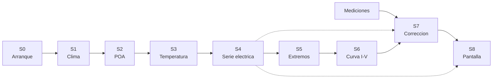

# 02 — La historia del dato: de la coordenada a la curva

> El espinazo del informe. Ocho estados, siempre contados igual: **qué entra, qué sale, qué
> funciones trabajan, quién las manda a hablar y qué se rompe**. Si entiendes un estado, entiendes
> los ocho.

**Convención de este documento:** todo lo que dice «línea» está en `legacy/`, y `el panel` es
`GIU_Final_Presetacion.py` (6.043 líneas) mientras `el módulo` es `Input_File_DIV_Mac_Informe.py`
(8.853). Las etiquetas de confianza son las del [README](README.md) §5.

---

## S0 — Arranque y superficie de entrada

**Qué entra.** Nada: el proceso arranca con valores por defecto.

**Qué sale.** El árbol de pantalla (`layout`) con todos los controles, y una aplicación Dash
escuchando en `:8050`.

| Función | Líneas | Qué hace |
|---|---|---|
| (cuerpo de `layout`) | panel `107-654` | construye la pantalla llamando a 22 factorías del módulo |
| `toggle_inputs` | panel `675-689` | decide qué inputs se muestran según el modo de placa |
| `filter_data`, `shower_list`, `data_handler` | panel `698-805` | filtran el catálogo CEC desde `Libro1.xlsx` |
| `update_map_center`, `angles_show`, `update_year_dropdown_visibility` | panel `816-1096` | mapa, ángulos y visibilidad de años |
| factorías de control | módulo `41-661` | `table_module`, `Dropdown_1..4`, `lat`, `lon`, `tilt`, `Azimuth`, `time_range`, `Data_filter`, `creador_de_filtros` |

**Quién manda a hablar.** Nadie. Es el punto de entrada: `app.run(debug=True)` en el panel
`6041-6042`, guardado por `if __name__ == '__main__'`. **No existe arranque programático**: no hay
CLI, no hay función `main`, no hay forma de ejecutar un caso sin abrir la interfaz. Es el mayor
obstáculo para congelar salidas (ver [11](11-por-donde-empezar.md)).

**Qué se rompe.** `toggle_inputs` devuelve 1 valor donde el decorador declara 13 salidas (panel
`689`), así que al arrancar sin selección salta `SchemaLengthMismatch`. La línea `678` parece un
error y no lo es: esos nombres son globales del módulo (panel `92-102`).

**Contrato que produce.** Ninguno de datos; produce **configuración**: once valores por defecto del
módulo de prueba (`Pot=250`, `Vm=30.12`, `Voc=37.85`, …) y seis casos de irradiancia/temperatura.

---

## S1 — Clima: de una coordenada a un diccionario de series

**Qué entra.** Latitud, longitud, tipo de año (`SY` con años concretos, o `TMY`) y el intervalo.

**Qué sale.** `NDH`: un diccionario cuyas **claves son la longitud de la serie** (`8760`, `17520`,
`35040`, `105120`) y cuyos valores son listas de DataFrames con índice temporal y columnas
`temp_air`, `wind_speed`, `ghi`, `dni`, `dhi`, `albedo`, `Year`, `Month`, `Day`, `Hour`, `Minute`.

| Función | Líneas | Qué hace |
|---|---|---|
| `clima` (callback) | panel `853-936` | orquesta la descarga y devuelve 7 salidas |
| `Clima` | `Primer_Funcion_Clima.py:64-183` | descarga NREL (PSM4 si existe, si no PSM3) |
| `obtener_utc_de_coordenadas` | `Primer_Funcion_Clima.py:35-38` | desfase horario **de hoy**, no del año analizado |
| `table_e`, `TMY` | módulo `167-276` | convierten `NDH` en tabla visible |
| `creador_csv_clima` | módulo `828-855` | escribe `g_{año}_{n}.csv` y devuelve la lista de rutas |

**Quién manda a hablar.** El callback `clima`, disparado por latitud, longitud, año y métodos
térmicos seleccionados. Dentro, el panel llama a `pf.Clima` y después a `cl.clc` y `ps.Solar_pos`
(S2).

**Qué garantiza.** Que exista una serie por resolución; que el CSV se llame `g_{año}_{n}.csv`.

**Qué no garantiza.** Nada sobre el contenido: si el año trae un número de filas distinto de la
rejilla (bisiesto, hueco de datos), **el DataFrame no entra en ninguna rama y desaparece sin aviso**.
Y el nombre del índice no lo fija quien escribe: lo hereda de pvlib (ver `00` §3).

**Qué se rompe.** Sin `NREL_API_KEY` y `NREL_API_EMAIL` en `.env`, `Clima` lanza `ValueError` y todo
lo demás queda sin datos. Con el pvlib instalado en la máquina de análisis (0.11.0) la rama PSM4 no
existe y siempre se usa el fallback PSM3.

---

## S2 — Irradiancia en el plano: el estado invisible

**Qué entra.** El mismo objeto `NDH` de S1.

**Qué sale.** **Nada.** `Solar_pos` no devuelve valor: **modifica los DataFrames en sitio**, añadiendo
`Poa_global`, `Poa_direct`, `Poa_diffuse`, `Poa_sky_diffuse` y `Poa_ground_diffuse`.

| Función | Líneas | Qué hace |
|---|---|---|
| `Solar_pos` | `Posicion_Solar.py:36-114` | inclinación = latitud, azimut = 180 |
| `Solar_pos_e` | `Posicion_Solar.py:116-194` | inclinación y azimut explícitos |
| `clc` | `Clima_Car.py:1-39` | agrupa temperaturas mínimas/máximas por hora; **su resultado se descarta** |

**Quién manda a hablar.** `clima`, en el panel `904-912`, según `Posicion_Modulo` (`Pos_i` o `Pos_e`).

**Por qué este estado es el más peligroso de todos.** Tres motivos:

1. **La comunicación es por efecto secundario.** El panel escribe
   `Effective_irradiance = ps.Solar_pos(...)` y esa variable vale `None`: nunca se usa. Quien consume
   la irradiancia no recibe un valor, sino los DataFrames mutados.
2. **Hay un orden obligatorio que no está en ninguna firma**: `clc` lee `temp_air/ghi/wind_speed`,
   `Solar_pos` añade `Poa_*`, y las funciones de S3 leen `Poa_global`. Invertir el orden no da error:
   da resultados distintos.
3. **`clc` se ejecuta para nada**: su resultado se tira en las dos ramas (panel `906` y `910`),
   y es un recorrido completo de todas las series.

**Qué se rompe.** `AMi = 1/cos(zenit)` sin acotar (`Posicion_Solar.py:78`), así que al amanecer y al
anochecer produce valores negativos o enormes. Aguas abajo se limpian los `inf` de `Voc`/`Vmax` y los
`NaN` de `Pmax`, **pero no** los de `Isc0`, `Imax` ni `Gamma`.

---

## S3 — Temperatura de célula: tres modelos, un resultado

**Qué entra.** `NDH` ya con `Poa_global`.

**Qué sale.** Tres columnas nuevas, una por modelo activo: `TFeinman`, `Tsandia`, `NOCT`.

| Función | Líneas | Modelo |
|---|---|---|
| `Temperature_feinman` | módulo `805-814` | `pvlib.temperature.faiman` con `u0`, `u1` ajustables |
| `Temperature_sandia` | módulo `785-800` | exponencial SAPM + conversión módulo→célula |
| `Temperature_NOCT` | módulo `817-825` | `T_a + (T_NOCT − 20)/800 · G` |

**Quién manda a hablar.** `clima`, panel `914-923`, según qué números haya en `checklist-input`.

**Qué se rompe.** Nada propio; el estado es corto y limpio. Su riesgo es de contrato: si un modelo
térmico se activa pero su columna no existe, el fallo aparece tres estados más allá, en S4, como
`KeyError` de una columna que el usuario nunca pidió.

---

## S4 — Serie eléctrica anual: el motor y su bus

**Qué entra.** `NDH` (por los CSV `g_*.csv`) y un diccionario de placa.

**Qué sale.** Un CSV por serie y por módulo (`PE_{año}_{n}.csv`, `PE2_{año}_{n}.csv`) con las
magnitudes horarias: `Isc0_*`, `Voc_*`, `Imax_*`, `Vmax_*`, `Pmax_*`, `Gamma_*` y la temperatura
usada, donde `*` es `F`, `S` o `NOCT`.

| Función | Líneas | Qué hace |
|---|---|---|
| `electric_parameters` (callback 1) | panel `1148-1441` | orquesta: 35 llamadas a `df_creator`, elige motor, escribe CSV |
| `df_creator` | módulo `1059-1129` | relee `g_*.csv`, pone índice `Time` |
| `PE`, `PE_t`, `PE_t_S` | módulo `1376-2318` | módulo 1: un modelo, dos modelos, o Feinman+Sandia |
| `PE_1`, `PE_t1`, `PE_t_S1` | módulo `2459-2761` | lo mismo para el módulo 2 |
| `PE_NOCT` | módulo `1524-2011` | cualquier combinación que incluya NOCT (488 líneas) |
| `Placa_Prueba`, `Placa_D1`, `Placa_D2` | módulo `982-1057` | construyen el diccionario de placa |
| `creador_csv_PE`, `creador_csv_PE2` | módulo `859-911` | escriben los CSV tras borrar los anteriores |

**Quién manda a hablar.** El callback `electric_parameters@1148`, disparado por el clima, la placa y
la selección de modelos. Dentro, llama al motor que corresponda **según la combinación**.

**La estructura que hay que ver.** Siete funciones `PE*` no son siete cálculos: son **el mismo
cálculo escrito siete veces**, una por combinación de modelos térmicos y por módulo. `PE` y `PE_1`
difieren en el sufijo; `PE_t` y `PE_t1` también. Es el patrón P1 del diagnóstico: 2³−1 combinaciones
desarrolladas a mano.

**Qué se rompe.**
- `PE_NOCT` evalúa `and 'NOCT':` (módulo `1663`), un literal siempre verdadero: si falta la columna,
  revienta en la línea siguiente.
- `Placa_Prueba` **sobrescribe sus once argumentos** con valores fijos (módulo `984-994`), así que
  cualquier ruta que la use simula un módulo de 250 W distinto del elegido.
- El CSV de salida depende de dos cosas invisibles: que el DataFrame traiga índice `Time` y que el
  número de filas caiga en la rejilla.

---

## S5 — Síntesis: de 8.760 horas a diez filas

**Qué entra.** La serie anual ya leída (lista de DataFrames) y `Seleccion`.

**Qué sale.** `resume_df`: una tabla de extremos (10, 20 o 30 filas: máximos y mínimos de
`Pmax`, `Imax`, `Vmax`, `Isc0`, `Voc` por modelo). `resume_IV`: las condiciones para trazar curvas
(5 filas con un modelo, 6 con dos, 9 con tres).

| Función | Líneas | Qué hace |
|---|---|---|
| `resume_df` | módulo `3100-4149` | 1.050 líneas, 7 ramas `if Seleccion ==` |
| `resume_IV` | módulo `4675-5603` | 929 líneas, 7 ramas, cada una termina en `return m` |

**Quién manda a hablar.** `electric_parameters@4182` (S6/S8), y en la ruta de un módulo también
`@1148`.

**Qué se rompe.**
- `round(d, 2)` sobre un diccionario en las ramas `[2]` (`3267`) y `[3]` (`3524`): `TypeError`, y la
  tabla no se genera **siempre** que se elige solo Sandia o solo NOCT.
- La fila llamada `"Temperatura minima"` contiene voltajes, en diez sitios, y ese rótulo llega a la
  leyenda de la gráfica.
- La rama `[1]` lee `Vmax_F` donde debería leer `Voc_F` (`3128-3129`); Sandia sí lee `Voc_S` (`3215`).
  La tabla de extremos de Feinman está mal y no da error.
- **132 asignaciones nunca se leen**: como cada rama termina en `return`, las magnitudes que esa
  rama no publica se calculan y se tiran (6 en `[1]`, 28 en `[1,2]`, 42 en `[1,2,3]`, 28 en
  `[1,3]`, 28 en `[2,3]`).

---

## S6 — Curva I-V: tres formas de resolver la misma ecuación

**Qué entra.** La placa y las condiciones de S5 (o las que fije el usuario, o una curva medida).

**Qué sale.** Una figura de Plotly y una tabla de resultados por curva.

| Función | Líneas | Método |
|---|---|---|
| `IV_R`, `IV_R1`, `IV_R2` | módulo `4268-4564` | puntos estadísticos: Lambert W sobre 100 puntos de tensión |
| `IV_R_VE` | módulo `4566-4671` | valores específicos: pares (G, T) que fija el usuario |
| `IV_CI`, `IV_CI2` | módulo `5607-5768`, `6651-6866` | comparación con medición |
| `IV_sim` | módulo `5771-5815` | simulación usada por la corrección |

**Quién manda a hablar.** `electric_parameters@4182` (13 salidas, 1.774 líneas) elige motor según
`Metodo`; `IV_Corrct@3791` y `Tabla_R_Boots@4045` componen el resto.

**Qué se rompe.**
- `IV_CI2` resta `float − list` en sus siete ramas (módulo `6790-6848`): `TypeError` al comparar con
  dos módulos.
- Las ramas de comparación leen `pd.read_csv("Uploaded_.csv")` en 32 sitios, pero el único escritor
  de ese `.csv` está comentado: `FileNotFoundError`. Solo funciona la rama que lee el `.xlsx`.
- `tableC2` se calcula con la placa del módulo 1 en siete líneas (`5456 … 5903`): las dos tablas
  resumen salen iguales y la comparación es falsa.

---

## S7 — Corrección y estadística: la parte que valida la tesis

**Qué entra.** El `.xlsx` de mediciones: una hoja por curva (`Volts`, `Amps`, `Watts`) y una hoja
`Info` **al final** con `CurveID, Normalized, Date/Time, Power, Isc, Voc, Ipeak, Vpeak, Fill Factor,
Irrad1, Temp1, Temp2`.

**Qué sale.** Curvas corregidas a condiciones estándar, tablas comparativas simulación/medición, y
una **curva representativa** con intervalo de confianza al 95 %.

| Función | Líneas | Qué hace |
|---|---|---|
| `IV_Corrct` (callback) | panel `3791-3963` | orquesta la corrección |
| `IV_CI_cor` | módulo `5819-6648` | 830 líneas: lee `Info`, recorre curvas, corrige |
| `correction_IV`, `correction_IV_s` | módulo `7304-7800` | métodos M2 y M2N (IEC 60891) |
| `Rs_e`, `find_k_sweep`, `Temperature_coeffs`, `linear_fit` | módulo `7080-7301` | ajuste de la resistencia serie y coeficientes |
| `minimos`, `minimos_s` | módulo `7803-8052` | extrapolan los extremos de la curva |
| `Bootstrap`, `Bootstrap2` | módulo `8358-8761` | 3.000 muestras de tamaño 12, media recortada al 5 % |
| `Comprobacion` | módulo `8764-8850` | tolerancia ±3 % frente a STC |

**Quién manda a hablar.** El callback `IV_Corrct`, que a su vez alimenta a `Tabla_select@3981` y
`Tabla_R_Boots@4045` por los stores `Tabla_Info*`, `Tablarm` y `Tablars`.

**El contrato real del fichero de mediciones** (verificado con un libro real de 30 curvas):

- **30 hojas** de curva y **una** `Info`, que debe ser **la última**: el código lee las curvas por
  posición (`sheet_name=i`). Si `Info` va primero, todo se desplaza en silencio.
- De las 12 columnas de `Info` se usan **cuatro**: `Voc`, `Irrad1`, `Temp1`, `Temp2`. La temperatura
  de célula es el promedio `(Temp1 + Temp2)/2`.
- **No se comprueba que el libro corresponda al módulo simulado.** Se puede comparar un módulo de
  227 W con una simulación de 570 W sin un solo aviso.

**Qué se rompe.**
- Los stores de resultados se inicializan a `0`, no a `{}`: elegir una tabla antes de corregir lanza
  `ValueError: DataFrame constructor not properly called`.
- Tres ramas de `Tabla_R_Boots` devuelven `{"style": "block"}` donde Dash espera `{"display": ...}`:
  los paneles no se muestran.
- La semilla del bootstrap no está fijada: dos corridas dan curvas representativas distintas.

---

## S8 — Pantalla: donde todo se encuentra

**Qué entra.** Los stores (12, de los cuales 2 son huérfanos) y las series en disco.

**Qué sale.** 13 salidas del callback de curvas, 7 del de clima, gráficas y tablas.

| Grupo | Callbacks | Qué cubre |
|---|---|---|
| Entrada | `toggle_inputs`, `filter_data`, `shower_list`, `data_handler`, `render_content` | placa y catálogo |
| Clima | `clima`, `use_ndh` | descarga, tablas y store de rutas |
| Series | `Graph_filter`, `update_graph`, `Voltaje_Corriente_Selector` (`1723` y `1742`) | dispersión, histogramas, V-I |
| Curvas | `electric_parameters@4182`, `Graph_filter_IV` | I-V, tablas, comparación |
| Corrección | `IV_Corrct`, `Tabla_select`, `Tabla_R_Boots` | corrección, tabla, bootstrap |

**Quién manda a hablar.** El navegador. Cada cambio de filtro dispara un callback, y ese callback
**vuelve a leer del disco**.

**Qué se rompe.**
- El filtro de año de dos módulos compara **carácter a carácter** (`5428-5431`): da siempre verdadero.
- Cuatro ramas quedaron fuera del filtro por una indentación de 20 espacios (`5662, 5735, 5808,
  5881`): devuelven el primer año y se saltan el elegido.
- Las etiquetas `"Año …"` y `"Year …"` no coinciden entre el desplegable y el consumidor: pantalla
  vacía sin error.
- `use_ndh` lee todos los CSV para devolver `None`.

---

## Lo que la historia deja claro

1. **El dato no fluye: se guarda y se relee.** Entre S4 y S8 hay disco en medio, y entre S1 y S2 hay
   mutación en sitio. Ninguna función recibe todo lo que necesita; lo completa con efectos sobre
   objetos compartidos y con ficheros en el directorio de trabajo.
2. **Cada estado tiene su propio contrato implícito**, y ninguno está escrito en el código. Ese es el
   trabajo de [03](03-contratos.md).
3. **El orden importa y no está declarado.** S2 después de S3, o `Info` antes de las curvas, no da
   error: da otro resultado.
