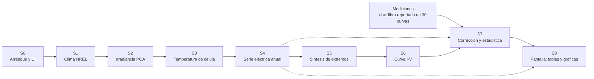

# SuNLiER — el sistema completo, contado de una vez

> **Qué es este documento.** El mapa holístico del software que corre hoy: qué entra, qué
> se transforma, qué sale, quién manda a hablar a cada función y dónde se rompe. No es un
> plan de negocio ni una propuesta de producto: conserva la investigación del autor sobre el
> legacy, con correcciones estáticas pendientes de revisión. El estado del backend moderno y las
> capturas ejecutadas se mantienen en [cobertura](../legacy_backend_coverage.md).

**Este documento no modifica el sistema.** `legacy/` es evidencia congelada por hash
(`docs/evidence/legacy_inventory.json`) y el CI falla si cambia un byte. Aquí solo se lee y se explica.

---

## 1. Lo que hay, en siete números

| # | Cifra | Qué significa |
|---|---|---|
| 1 | **14.896 líneas · 109 funciones** en dos ficheros | tamaño bruto de los dos ficheros principales; no incluye los cinco módulos externos. AST y rangos contrastados. |
| 2 | **7.013 líneas en 6 funciones** | 51,9 % de las 13.516 líneas de funciones; 47,1 % de las 14.896 líneas brutas. `electric_parameters@4182`, `Voltaje_Corriente_Selector@1742`, `resume_df`, `resume_IV`, `IV_CI_cor`, `PE_NOCT`. |
| 3 | **91 % de duplicación reportado por el autor** | 1.619 de 1.774 líneas, 44 grupos y 166 bloques; el método y los scripts de ese cómputo no están en este checkout. |
| 4 | **6 funciones desconectadas en el grafo estático** | 564 líneas: 4,2 % de las líneas de funciones, 3,8 % de las líneas brutas. No demuestra ausencia de consumidores externos. |
| 5 | **12 `dcc.Store` y 2 huérfanos** | `selected-rows-store` no tiene ni escritor ni lector; `Prueba` se escribe y nadie lo lee |
| 6 | **7 combinaciones térmicas × 3 métodos × 3 tipos de placa** | el callback `electric_parameters@4182` contiene 84 `if Metodo ==`, 28 `if Seleccion ==` y 113 sentencias `return`, todas de 13 salidas. No son 113 salidas distintas ni prueba del producto cartesiano completo. |
| 7 | **13 hallazgos estáticos, con condiciones por verificar** | ver [`06-lo-que-esta-roto.md`](06-lo-que-esta-roto.md); `B-09` depende del tipo numérico y no prueba una excepción universal. |

El diagnóstico estructural es la repetición de ramas para modelos térmicos, método de curva,
origen de placa, número de módulos y corrección. La coherencia física requiere una evaluación
separada: usar pvlib o citar un método no valida sus parámetros ni su aplicación. Véanse
[las decisiones](10-decisiones-pendientes.md) y [las suposiciones canónicas](../assumptions.md). #to-review

---

## 2. La historia en una imagen

El mapa distingue nueve estados, S0–S8. Las flechas resumen dependencias, no una ejecución
completa demostrada. Las 30 curvas del libro son evidencia reportada por el autor; el libro no
está disponible en este checkout. #to-review

La diferencia entre la línea continua y la discontinua es real y está en el código: S8 (los
callbacks) no solo recibe el resultado final, también consume las series crudas de S4 y los
resultados de S7. **La presentación está acoplada a tres estados a la vez.** Es una de las razones
por las que el sistema es difícil de tocar.

---

## 3. Cómo se lee esto

| Si tienes… | Lee | Sirve para |
|---|---|---|
| **10 minutos** | [01](01-el-sistema-en-una-pagina.md) y [catálogo canónico](../README.md) | distinguir el legacy del backend actual; 09 conserva una propuesta, no la arquitectura vigente. |
| **una transformación** | [02](02-historia-del-dato.md), contrato de [03](03-contratos.md) y fila de [cobertura](../legacy_backend_coverage.md) | entender dependencias y el siguiente trabajo sustentado; recuperar solo las secciones pertinentes. |
| **una discrepancia** | [06](06-lo-que-esta-roto.md) y el símbolo citado | caracterizar condiciones y buscar una captura antes de corregir. |
| **eres un agente** | [`index.json`](index.json) | resolver `S5` o `F-046` sin leer 14.896 líneas; verificar después el estado actual en cobertura. |

`AGENTS.md` prohíbe ingerir `legacy/` de forma recursiva. Este directorio existe para que no
haga falta: el índice resuelve identificadores a fichero, líneas, estado y contratos.

---

## 4. El sistema de identificadores

Todo lo que se menciona en estos documentos tiene un nombre estable, para que una persona y un
agente puedan hablar de lo mismo sin ambigüedad.

| Prefijo | Qué identifica | Ejemplo |
|---|---|---|
| `S0`…`S8` | estado del pipeline | `S4` = serie eléctrica anual |
| `F-###` | función | `F-046 · PE_NOCT · Input_File_DIV_Mac_Informe.py:1524-2011`. |
| `C-###` | contrato de datos en una frontera | `C-03 · PE_{Year}_{t}.csv`, índice `Time` |
| `B-###` | hallazgo de defecto y sus condiciones | `B-07 · round(dict, 2) en resume_df`; comprobar estado de verificación en 06. |
| `D-###` | decisión de diseño pendiente | `D-01 · formulaciones completas de potencia anual y sus unidades`. |
| `R-###` | riesgo operativo | `R-03 · Info debe ser la última hoja`. |

---

## 5. Cuánto se puede confiar en cada frase

La investigación original distingue estas cuatro etiquetas; su aplicación no es exhaustiva.
En esta revisión, «contrastado con fuente» significa inspección estática, no ejecución.

| Etiqueta | Significa | Cómo se comprueba |
|---|---|---|
| **medido** | cifra atribuida al análisis original | Los scripts del repo de análisis no se suministraron. Aquí se contrastaron inventario, rangos y alcanzabilidad; duplicación/similitud siguen reportadas, no reproducidas. #to-review |
| **verificado** | lo redactó un modelo y una persona lo contrastó abriendo la línea | se cita `fichero:línea` |
| **propuesta** | es una opinión de diseño, con su coste | se discute, no se cita como hecho |
| **indeterminable** | no se puede saber leyendo el código | se dice por qué |

Este mapa se elaboró mediante análisis estático. Los síntomas de excepción o pantalla requieren
las condiciones descritas y captura independiente. Las capturas parciales posteriores del backend
se registran en [reproducción](../reproduction.md); no certifican todos los caminos del panel.

---

## 6. Qué no está aquí, y por qué

- **Benchmarks de modelos** (topes de tokens, `--jobs`, calibración de modelos locales): pertenecen
  al taller de análisis, no al software. No aportan nada a quien va a reescribir el programa.
- **Las 103 fichas automáticas** que se generaron para cada función: un tercio resultó inventado en
  la auditoría. Donde una ficha se usó como evidencia, la afirmación está re-verificada contra el
  código y citada por línea, no por ficha.
- **Costes y operación**: fuera de alcance.

Se conservan los localizadores y las conclusiones del autor. Cuando el script o el artefacto
original no está disponible, la cifra queda atribuida al informe y pendiente de reproducción;
una referencia ausente no cuenta como verificación independiente.

---

## 7. Reglas de uso

1. `legacy/` es de solo lectura. Ni formatear, ni reparar, ni importar su UI.
2. Este informe **no decide** las cuestiones físicas abiertas. Las lista en
   [`10-decisiones-pendientes.md`](10-decisiones-pendientes.md) para que las decidan las personas.
3. Si una afirmación de aquí contradice al código, gana el código. Abre la línea: si no cuadra,
   es un error del informe y se corrige.
4. La reproducción completa no está establecida. Las capturas parciales y sus límites se mantienen
   en [cobertura](../legacy_backend_coverage.md) y [reproducción](../reproduction.md); el capítulo
   [11](11-por-donde-empezar.md) conserva el planteamiento inicial del autor.

---

## 8. Índice de documentos

| Documento | Contenido | Estado |
|---|---|---|
| [00-convenciones](00-convenciones.md) | glosario, unidades, nombres de índice, convenciones de tiempo | investigación del autor; estado actual en cobertura |
| [01-el-sistema-en-una-pagina](01-el-sistema-en-una-pagina.md) | el sistema completo en una página | investigación del autor; estado actual en cobertura |
| [02-historia-del-dato](02-historia-del-dato.md) | S0→S8, el espinazo | investigación del autor; estado actual en cobertura |
| [03-contratos](03-contratos.md) | qué entra y qué sale en cada frontera | investigación del autor; estado actual en cobertura |
| [04-inventario](04-inventario.md) | las 109 funciones con su estado real | investigación del autor; estado actual en cobertura |
| [05-lo-que-no-sirve](05-lo-que-no-sirve.md) | duplicación, código muerto, ramas imposibles | investigación del autor; estado actual en cobertura |
| [06-lo-que-esta-roto](06-lo-que-esta-roto.md) | los 13 defectos | investigación del autor; estado actual en cobertura |
| [07-lo-que-falta](07-lo-que-falta.md) | lo nunca terminado y qué haría falta | investigación del autor; estado actual en cobertura |
| [08-tesis-a-codigo](08-tesis-a-codigo.md) | de qué función sale cada figura del informe de licenciatura | investigación del autor; estado actual en cobertura |
| [09-refactor-propuesto](09-refactor-propuesto.md) | de X líneas a Y, estado por estado | investigación del autor; estado actual en cobertura |
| [10-decisiones-pendientes](10-decisiones-pendientes.md) | lo que hay que decidir antes de reescribir | investigación del autor; estado actual en cobertura |
| [11-por-donde-empezar](11-por-donde-empezar.md) | congelado, arnés y orden de ataque | investigación del autor; estado actual en cobertura |

---

## 9. Cómo nació esto

El autor reporta análisis estático (AST, alcanzabilidad, duplicación y contratos), revisión
adversarial y contraste con su informe de licenciatura y un libro de 30 curvas. La auditoría
posterior comprobó aquí los 109 localizadores, 11 símbolos externos y las afirmaciones
consecuentes de 00–06 contra el código congelado. El libro y los scripts de métricas originales
no están disponibles: sus resultados siguen atribuidos al autor.

Si encuentras un error, el criterio es uno: **abre la línea citada**. Si no dice lo que el informe
afirma, el informe está mal.
