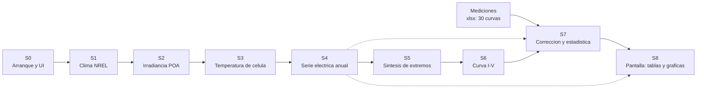

# SuNLiER — el sistema completo, contado de una vez

> **Qué es este documento.** El mapa holístico del software que corre hoy: qué entra, qué
> se transforma, qué sale, quién manda a hablar a cada función y dónde se rompe. No es un
> plan de negocio ni una propuesta de producto: es el estado real del sistema, con cada
> afirmación anclada a una línea del código, para que dos personas y sus agentes puedan
> trabajar sobre el mismo entendimiento.

**Este documento no modifica el sistema.** `legacy/` es evidencia congelada por hash
(`docs/evidence/legacy_inventory.json`) y el CI falla si cambia un byte. Aquí solo se lee y se explica.

---

## 1. Lo que hay, en siete números

| # | Cifra | Qué significa |
|---|---|---|
| 1 | **14.896 líneas · 109 funciones** en dos ficheros | el tamaño bruto del sistema activo |
| 2 | **52 % del código vive en 6 funciones** | `electric_parameters@4182`, `Voltaje_Corriente_Selector@1742`, `resume_df`, `resume_IV`, `IV_CI_cor`, `PE_NOCT` |
| 3 | **91 % de `electric_parameters@4182` es duplicado exacto** | 1.619 de 1.774 líneas, en 44 grupos y 166 bloques |
| 4 | **4,2 % es código desconectado** | 6 funciones, 564 líneas, de 109 totales |
| 5 | **12 `dcc.Store` y 2 huérfanos** | `selected-rows-store` no tiene ni escritor ni lector; `Prueba` se escribe y nadie lo lee |
| 6 | **7 combinaciones térmicas × 3 métodos × 3 tipos de placa, escritas una por una** | en vez de configurarse, cada combinación tiene su bloque de código: 84 bloques y 113 salidas distintas, escritos a mano |
| 7 | **13 defectos verificados, 4 de ellos rompen el dato** | ver [`06-lo-que-esta-roto.md`](06-lo-que-esta-roto.md) |

El diagnóstico de una línea: **el problema no es el dominio, es la copia.** La física está bien
planteada; lo que falla es que las dimensiones del problema (modelos térmicos, método de curva,
origen de la placa, número de módulos, corrección sí/no) se escribieron como producto cartesiano
en vez de como configuración.

---

## 2. La historia en una imagen

El dato recorre ocho estados. Cada uno tiene su documento, sus funciones y sus contratos.

La diferencia entre la línea continua y la discontinua es real y está en el código: S8 (los
callbacks) no solo recibe el resultado final, también consume las series crudas de S4 y los
resultados de S7. **La presentación está acoplada a tres estados a la vez.** Es una de las razones
por las que el sistema es difícil de tocar.

---

## 3. Cómo se lee esto

| Si tienes… | Lee | Sirve para |
|---|---|---|
| **10 minutos** | [01](01-el-sistema-en-una-pagina.md) y [09](09-refactor-propuesto.md) | saber qué hay y a dónde va |
| **1 hora** | 01 → [02](02-historia-del-dato.md) → [09](09-refactor-propuesto.md) → [11](11-por-donde-empezar.md) | entender el sistema y qué atacar primero |
| **un día** | todo en orden | trabajar sobre él |
| **eres un agente** | [`index.json`](index.json) | resolver `S5` o `F-112` sin leer 14.896 líneas |

`AGENTS.md` prohíbe ingerir `legacy/` de forma recursiva. Este directorio existe para que no
haga falta: el índice resuelve identificadores a fichero, líneas, estado y contratos.

---

## 4. El sistema de identificadores

Todo lo que se menciona en estos documentos tiene un nombre estable, para que una persona y un
agente puedan hablar de lo mismo sin ambigüedad.

| Prefijo | Qué identifica | Ejemplo |
|---|---|---|
| `S0`…`S8` | estado del pipeline | `S4` = serie eléctrica anual |
| `F-###` | función | `F-112 · PE_NOCT · Input_File_DIV_Mac_Informe.py:1524-2011` |
| `C-###` | contrato de datos en una frontera | `C-03 · PE_{Year}_{t}.csv · índice `Time`` |
| `B-###` | defecto verificado | `B-07 · round(dict, 2) en resume_df` |
| `D-###` | decisión de diseño pendiente | `D-02 · 1000/G o G/1000` |
| `R-###` | riesgo operativo | `R-04 · Info debe ser la última hoja` |

---

## 5. Cuánto se puede confiar en cada frase

Cada afirmación del informe lleva una de estas cuatro etiquetas. No hay ninguna sin etiqueta.

| Etiqueta | Significa | Cómo se comprueba |
|---|---|---|
| **medido** | lo cuenta un script determinista sobre el AST | `python3 benchmarks/tools/*.py` en el repo de análisis |
| **verificado** | lo redactó un modelo y una persona lo contrastó abriendo la línea | se cita `fichero:línea` |
| **propuesta** | es una opinión de diseño, con su coste | se discute, no se cita como hecho |
| **indeterminable** | no se puede saber leyendo el código | se dice por qué |

Y un aviso que vale para todo el documento: **el sistema no se ha ejecutado.** Este mapa es
análisis estático. Todo lo que dice «lanza una excepción» o «la pantalla queda vacía» es una
deducción del código, no una observación de una corrida. Está dicho donde importa.

---

## 6. Qué no está aquí, y por qué

- **Benchmarks de modelos** (topes de tokens, `--jobs`, calibración de modelos locales): pertenecen
  al taller de análisis, no al software. No aportan nada a quien va a reescribir el programa.
- **Las 103 fichas automáticas** que se generaron para cada función: un tercio resultó inventado en
  la auditoría. Donde una ficha se usó como evidencia, la afirmación está re-verificada contra el
  código y citada por línea, no por ficha.
- **Costes y operación**: fuera de alcance.

Lo que sí se conserva de todo ese trabajo es la disciplina: **ninguna cifra de este informe se
apoya en lo que dijo un modelo. Se apoya en una línea o en un script.**

---

## 7. Reglas de uso

1. `legacy/` es de solo lectura. Ni formatear, ni reparar, ni importar su UI.
2. Este informe **no decide** las cuestiones físicas abiertas. Las lista en
   [`10-decisiones-pendientes.md`](10-decisiones-pendientes.md) para que las decidan las personas.
3. Si una afirmación de aquí contradice al código, gana el código. Abre la línea: si no cuadra,
   es un error del informe y se corrige.
4. La paridad numérica no está establecida: no existe captura independiente de las salidas del
   sistema actual. [`11-por-donde-empezar.md`](11-por-donde-empezar.md) explica qué falta.

---

## 8. Índice de documentos

| Documento | Contenido | Estado |
|---|---|---|
| [00-convenciones](00-convenciones.md) | glosario, unidades, nombres de índice, convenciones de tiempo | completo |
| [01-el-sistema-en-una-pagina](01-el-sistema-en-una-pagina.md) | el sistema completo en una página | completo |
| [02-historia-del-dato](02-historia-del-dato.md) | S0→S8, el espinazo | completo |
| [03-contratos](03-contratos.md) | qué entra y qué sale en cada frontera | completo |
| [04-inventario](04-inventario.md) | las 109 funciones con su estado real | completo |
| [05-lo-que-no-sirve](05-lo-que-no-sirve.md) | duplicación, código muerto, ramas imposibles | completo |
| [06-lo-que-esta-roto](06-lo-que-esta-roto.md) | los 13 defectos | completo |
| [07-lo-que-falta](07-lo-que-falta.md) | lo nunca terminado y qué haría falta | completo |
| [08-tesis-a-codigo](08-tesis-a-codigo.md) | de qué función sale cada figura del informe de licenciatura | completo |
| [09-refactor-propuesto](09-refactor-propuesto.md) | de X líneas a Y, estado por estado | completo |
| [10-decisiones-pendientes](10-decisiones-pendientes.md) | lo que hay que decidir antes de reescribir | completo |
| [11-por-donde-empezar](11-por-donde-empezar.md) | congelado, arnés y orden de ataque | completo |

---

## 9. Cómo nació esto

Análisis estático determinista sobre `legacy/` (AST, alcanzabilidad, duplicación, contratos),
auditoría adversarial de las conclusiones contra el código, y contraste con el informe de
licenciatura del autor y con el libro de mediciones real (30 curvas I-V). Los desacuerdos entre
fuentes se resolvieron abriendo la línea, no votando.

Si encuentras un error, el criterio es uno: **abre la línea citada**. Si no dice lo que el informe
afirma, el informe está mal.
